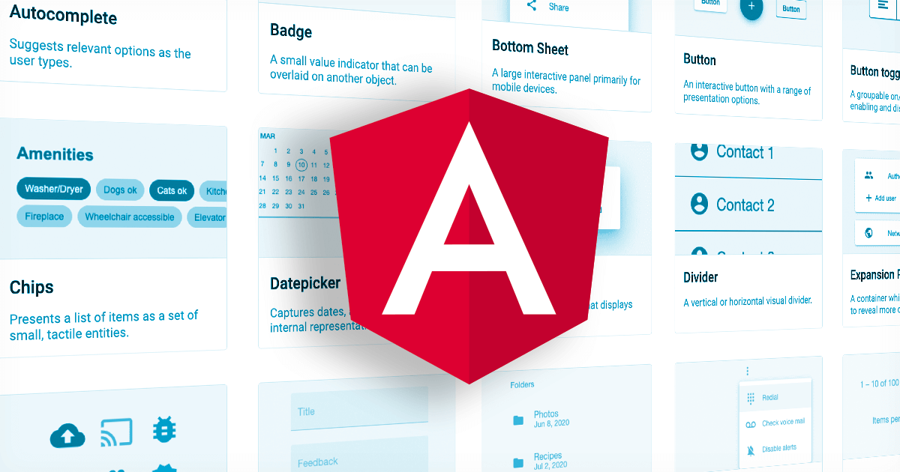

# Guía Explicativa: Angular Material & Angular



## 1. ¿Qué es Angular Material?

**Angular Material** es la librería oficial de componentes de interfaz de usuario (UI) para Angular. Implementa las especificaciones de **Material Design** de Google y está construida directamente sobre el núcleo de Angular.

A diferencia de otras librerías CSS tradicionales (como Bootstrap o Tailwind), Angular Material no solo ofrece estilos visuales, sino **componentes inteligentes en TypeScript** con lógica de estado, manejo de teclado y accesibilidad (a11y) integrados nativamente.

---

## 2. Automatización con Angular CLI (`ng add`)

Al ejecutar el comando de instalación:

```bash
ng add @angular/material
```

El ejecutable de esquemáticos (_schematics_) de Angular realiza automáticamente las siguientes acciones en la arquitectura del proyecto:

1. **Gestión de paquetes:** Instala `@angular/material`, `@angular/cdk` y `@angular/animations` en `package.json`.
2. **Inyección de estilos globales:** Genera o actualiza la configuración de temas en `angular.json` e importa la paleta de colores seleccionada.
3. **Carga de recursos externos:** Agrega las etiquetas `<link>` en `src/index.html` para cargar la tipografía _Roboto_ y la librería de iconos _Material Icons_.
4. **Configuración de animaciones:** Registra `provideAnimationsAsync()` dentro de `app.config.ts` para habilitar transiciones fluidas sin penalizar la carga inicial del sitio.

---

## 3. Integración en Arquitectura Standalone (Angular 14+)

Angular utiliza por defecto componentes **Standalone**, lo que significa que ya no dependes de módulos globales (`NgModules`) para cargar librerías visuales.

Para utilizar cualquier componente de Angular Material, se sigue el patrón de **importación modular directa**:

### Ejemplo de integración en TypeScript (`.ts`)

```typescript
import { Component } from '@angular/core';
// 1. Importar el módulo específico de Angular Material
import { MatButtonModule } from '@angular/material/button';
import { MatIconModule } from '@angular/material/icon';

@Component({
  selector: 'app-ejemplo',
  standalone: true,
  // 2. Agregarlo al arreglo de imports del componente
  imports: [MatButtonModule, MatIconModule],
  templateUrl: './ejemplo.component.html',
})
export class EjemploComponent {}
```

### Ejemplo en plantilla HTML (`.html`)

```html
<!-- 3. Usar las directivas o etiquetas nativas de Material -->
<button mat-raised-button color="primary">
  <mat-icon>add</mat-icon>
  Guardar
</button>
```

---

## 4. El Component Dev Kit (CDK)

Angular Material incluye por debajo la librería `@angular/cdk` (_Component Dev Kit_). El CDK abstrae el comportamiento complejo del DOM sin imponer estilos visuales:

- **Accesibilidad (a11y):** Manejo de foco con teclado, soporte para lectores de pantalla mediante atributos ARIA.
- **Overlays y Popups:** Posicionamiento flotante para menús, modales y _tooltips_.
- **Drag and Drop:** Funcionalidades avanzadas para arrastrar elementos en listas.
- **Virtual Scrolling:** Renderizado optimizado para listas masivas de datos.

---

## 5. El Sistema de Temas (Theming)

El diseño visual en Angular Material se basa en **paletas de colores dinámicas** compuestas por tres roles principales:

1. **Primary:** Color predominante en la interfaz (marcas de navegación, botones principales).
2. **Accent / Secondary:** Color de contraste utilizado en elementos flotantes o seleccionados.
3. **Warn:** Color reservado para estados de error, advertencia o acciones destructivas (eliminar).

---

## 6. Categorías Principales de Componentes

| Categoría           | Módulos representativos                                    | Casos de uso típicos                                                       |
| :------------------ | :--------------------------------------------------------- | :------------------------------------------------------------------------- |
| **Form Controls**   | `MatInputModule`, `MatSelectModule`, `MatCheckboxModule`   | Captura de datos en formularios y validaciones de entrada.                 |
| **Navigation**      | `MatToolbarModule`, `MatSidenavModule`, `MatMenuModule`    | Encabezados, barras superiores y menús laterales colapsables.              |
| **Layout**          | `MatCardModule`, `MatExpansionModule`, `MatListModule`     | Organización del contenido en contenedores, acordeones o tarjetas.         |
| **Data Table**      | `MatTableModule`, `MatPaginatorModule`, `MatSortModule`    | Renderizado de estructuras masivas de datos con ordenamiento y paginación. |
| **Popups & Modals** | `MatDialogModule`, `MatSnackBarModule`, `MatTooltipModule` | Ventanas emergentes de confirmación y notificaciones flotantes temporales. |
